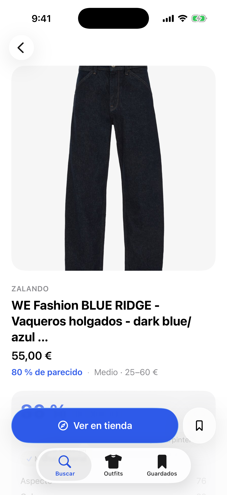
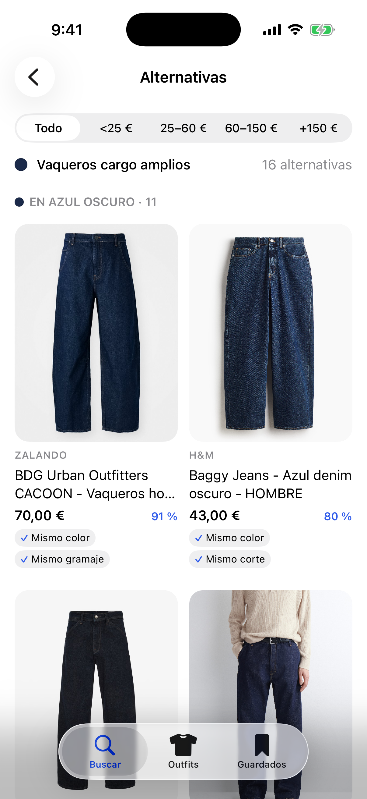
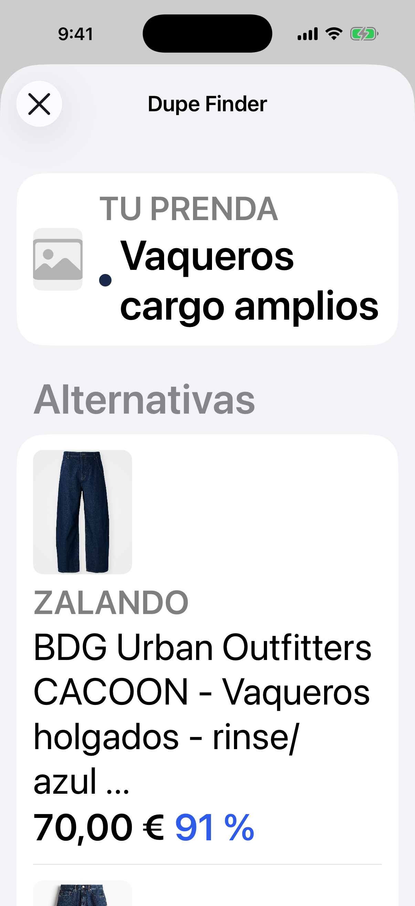
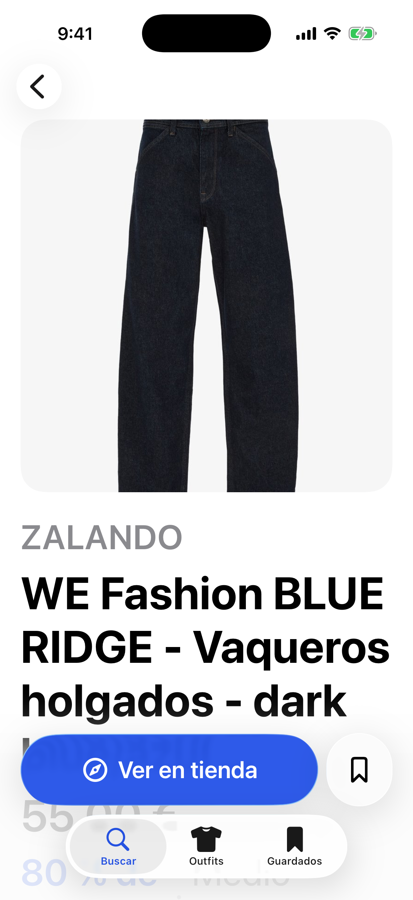
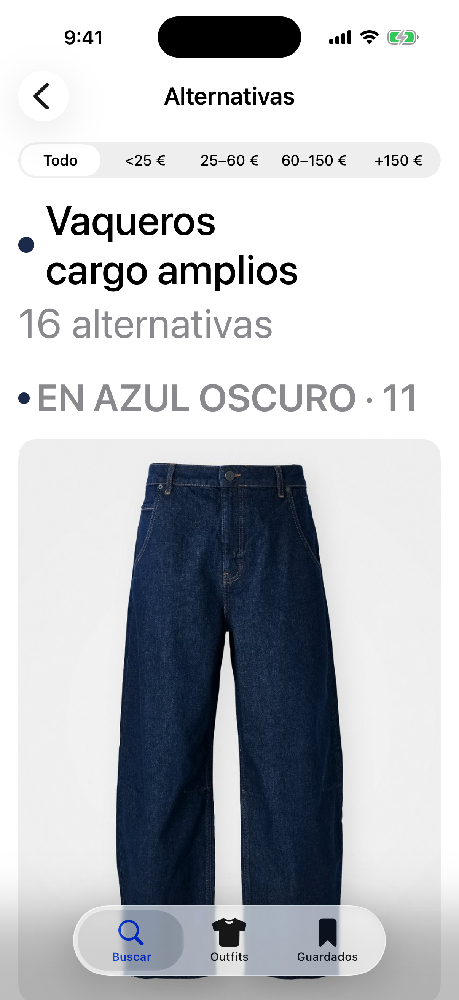
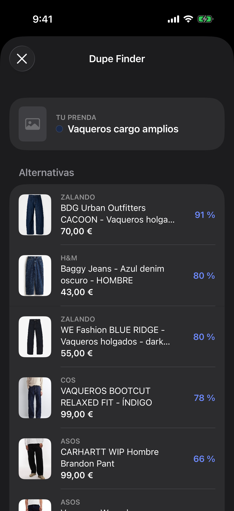
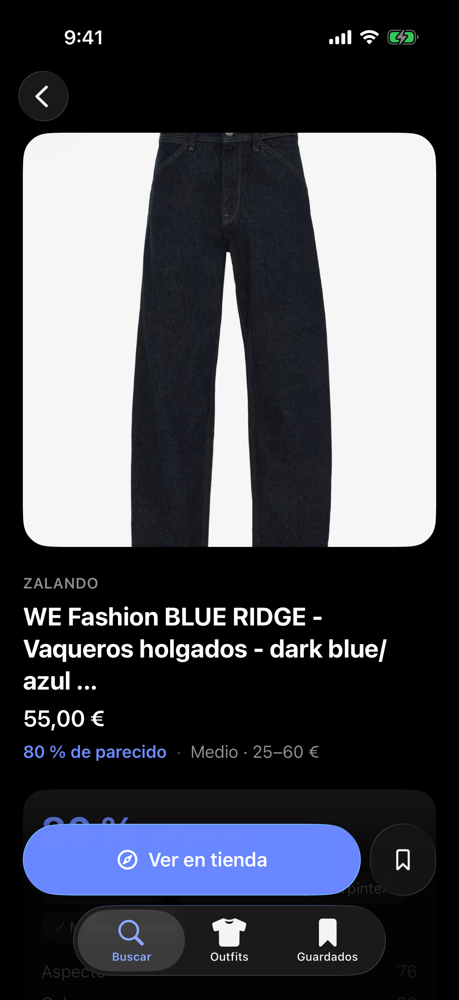
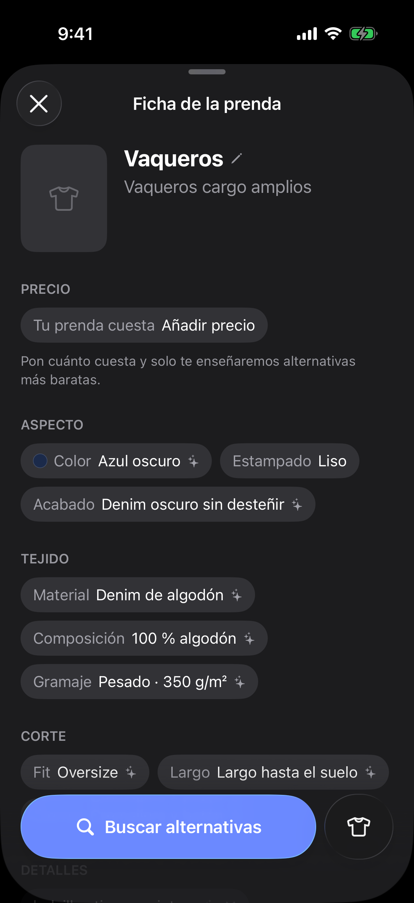
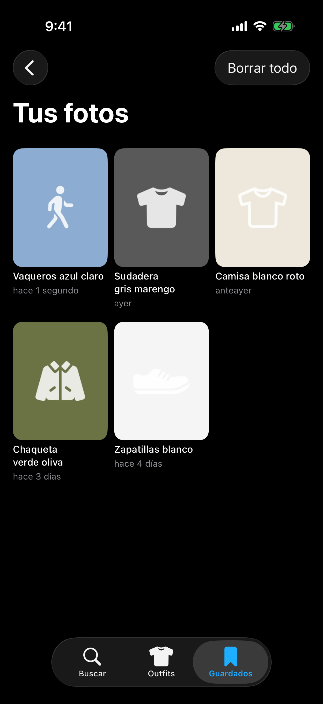
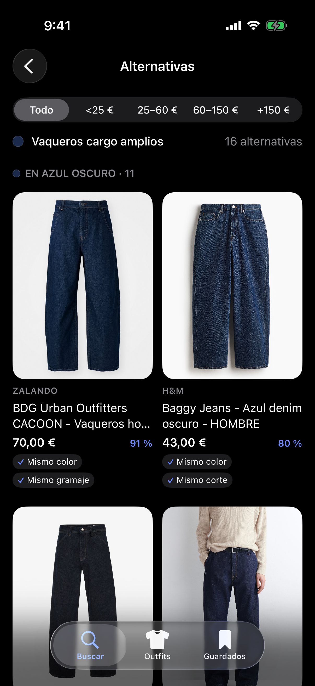

# Capturas de la app

Commit `d47ac27` · [ver la ejecución](https://github.com/Beeltraan25/APP/actions/runs/40585696174)

Resultado: `paquete=success compilar=success tests=success capturas=success ipa=success`

### claro-compartir

### claro-detalle

### claro-ficha

### claro-guardados

### claro-historial

### claro-inicio

### claro-inspiracion

### claro-menu

### claro-outfitGuardado

### claro-outfits

### claro-resultados

### grande-compartir

### grande-detalle

### grande-inicio

### grande-outfitGuardado

### grande-outfits

### grande-resultados

### oscuro-compartir

### oscuro-detalle

### oscuro-ficha

### oscuro-guardados

### oscuro-historial

### oscuro-inicio

### oscuro-inspiracion

### oscuro-menu

### oscuro-outfitGuardado

### oscuro-outfits

### oscuro-resultados

